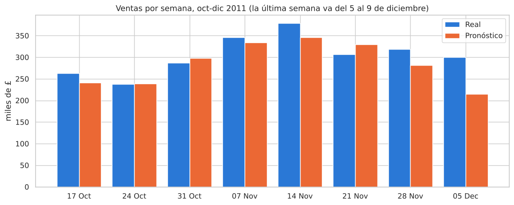
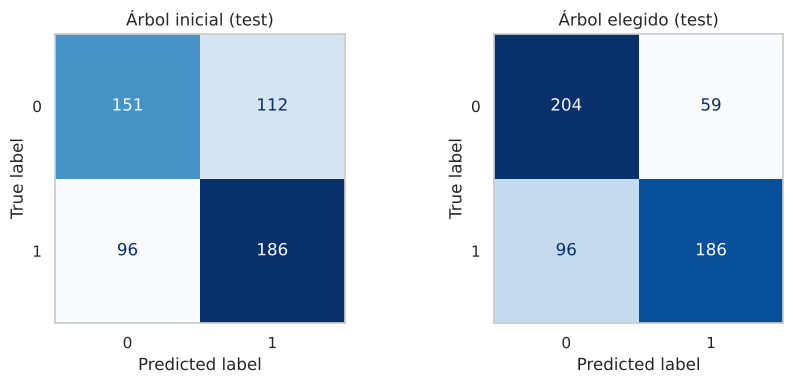
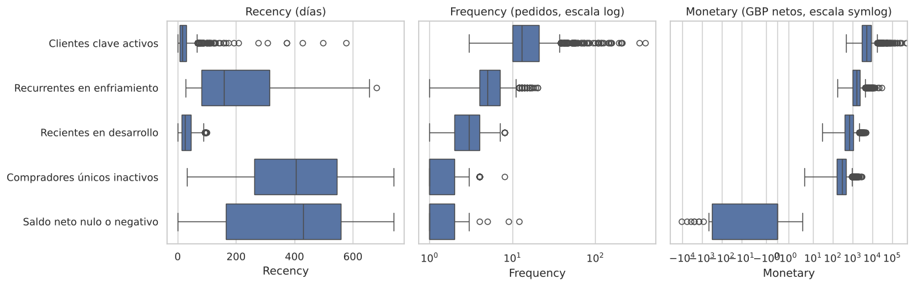

# 🛍️📈 Online Retail Growth Analytics: Forecasting, Repurchase & Segmentation

A Python data science project that turns two years of transactions from a UK gift wholesaler (**North Quay Gifts**, based on the *Online Retail II* dataset) into a peak-season plan: how much the store will sell, which customers will come back, which ones are drifting away, and what to do about each group.

<p align="center">
  
</p>

## 🎯 Business Questions

1. **Forecasting:** How much net revenue will the store make on the next business day during peak season?
2. **Repurchase:** Which customers will buy again in the next 90 days, and which ones need a win-back action?
3. **Segmentation:** What groups of customers exist, and what action should we test with each one?

## 🚀 Approach and Results

### I. Sales Forecasting (daily net revenue)
- One-step-ahead forecast with **Ridge regression** using lagged sales and calendar features (no same-day information, to avoid leakage).
- Model selected with **TimeSeriesSplit** (5 chronological cuts) against three naive baselines and Gradient Boosting; the last 47 business days were used only once, as a final test.
- Missing dates were treated as non-operating days (Saturdays and UK holidays), not as zero sales.

| Model (test, 47 business days) | MAE | RMSE | R² | vs. baseline |
|---|---|---|---|---|
| **Selected:** Ridge with lags + calendar | **£10,481** | £15,002 | 0.26 | **21% less error** |
| Ridge with lags only | £11,572 | £15,483 | 0.21 | 13% less error |
| Baseline: same weekday last week | £13,236 | £17,704 | −0.04 | — |

Summed by week, the forecast is off by **9.0%** on average vs. **13.0%** for the baseline, so it is most useful for weekly capacity planning.

### II. Repurchase Prediction (90-day horizon)
- **Decision tree** tuned with stratified 5-fold cross-validation (`max_depth`, `min_samples_leaf`), optimizing F1 for the repurchase class.
- The unrestricted tree memorized the data (100% train vs. 61.8% test accuracy); the tuned tree (depth 4, 15 leaves) generalizes with nearly identical train and test scores.
- Test results: **F1 = 0.706**, accuracy 71.6%, and it finds **77.6%** of the customers who will not come back.

<p align="center">
  
</p>

**Actionable rules extracted from the tree:**
- **Loyalty:** net spend between £685.93 and £2,182.20 and more than 4 orders in six months → 87.7% repurchase.
- **Win-back:** net spend of £275.60 or less and 101 to 157 days without buying → only 23.1% repurchase.

### III. Customer Segmentation (RFM + K-Means)
- Recency, Frequency and Monetary features with `log1p` and a **signed log** transform, so customers with zero or negative net spend (returns exceeding purchases) stay in the analysis.
- **K-Means with k = 5** (silhouette 0.374 vs. 0.357 for k = 4), chosen because the fifth group isolates customers whose returns cancel out their purchases.

| Segment | Customers | Median recency | Median orders | Share of net revenue |
|---|---|---|---|---|
| Key customers | 1,122 (19.1%) | 16 days | 13 | **71.9%** |
| Cooling down | 1,391 (23.7%) | 158 days | 5 | 17.3% |
| New and growing | 1,286 (21.9%) | 25 days | 3 | 6.5% |
| One-time buyers | 2,036 (34.6%) | 405 days | 1 | 4.4% |
| Net zero or negative | 43 (0.7%) | 429 days | 1 | −0.2% |

<p align="center">
  
</p>

## 💡 Recommendation: a Win-Back Pilot with a Control Group

The model identifies who tends not to come back, but it does not prove that an offer causes a purchase. So instead of a full rollout, we propose a **randomized pilot**: 3 in 4 win-back customers receive the offer and 1 in 4 receive nothing. The **90-day repurchase rate** of both groups is compared to measure the real effect of the campaign.

The full business report is in [`report/North_Quay_Peak_Season_Plan.pdf`](report/North_Quay_Peak_Season_Plan.pdf).

## 🛠️ Technologies Used

- **Language:** Python 3
- **Machine Learning:** scikit-learn (Ridge, Gradient Boosting, Decision Tree, K-Means, TimeSeriesSplit, StratifiedKFold)
- **Data Wrangling:** pandas, NumPy
- **Visualization:** Matplotlib, Seaborn

## 📁 Project Structure

```
├── assets/        # Figures used in this README
├── data/          # Input CSVs (see data/README.md)
├── notebook/      # main.ipynb: full analysis (in Spanish)
├── report/        # Business report (English)
└── requirements.txt
```

## ⚙️ Installation and Usage

```bash
git clone https://github.com/YOUR_USERNAME/online-retail-growth-analytics.git
cd online-retail-growth-analytics
python -m venv .venv
source .venv/bin/activate  # On Windows: .venv\Scripts\activate
pip install -r requirements.txt
jupyter notebook notebook/main.ipynb
```

Place the input CSVs in `data/` first (see [`data/README.md`](data/README.md)). To run it in Google Colab, upload the CSVs and set `DATA = "/content/"` in the first code cell.


## 📝 Licenses

- **Code:** distributed under the [MIT License](LICENSE).
- **Data:** derived from the [Online Retail II](https://archive.ics.uci.edu/dataset/502/online+retail+ii) dataset (UCI Machine Learning Repository, Daqing Chen), licensed under [CC BY 4.0](https://creativecommons.org/licenses/by/4.0/). *North Quay Gifts* is the case name used in the course.
